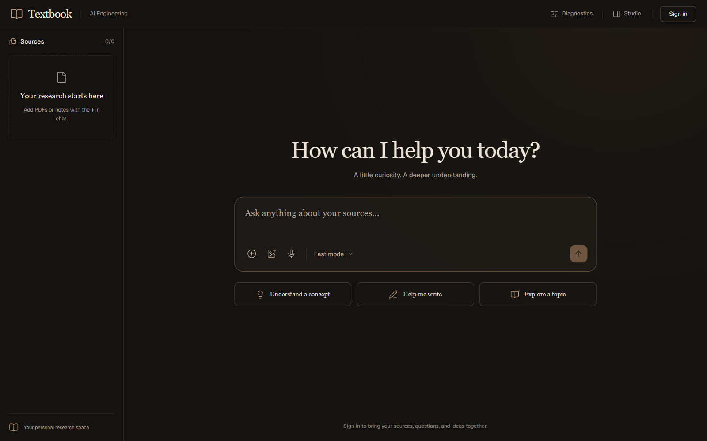
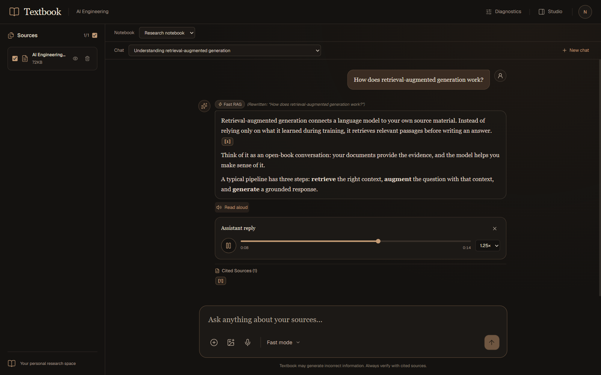
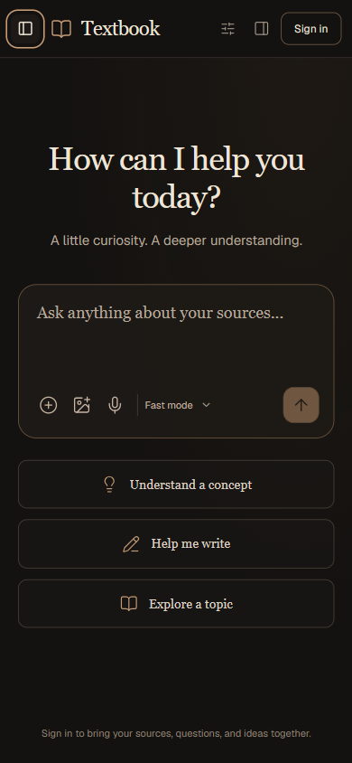
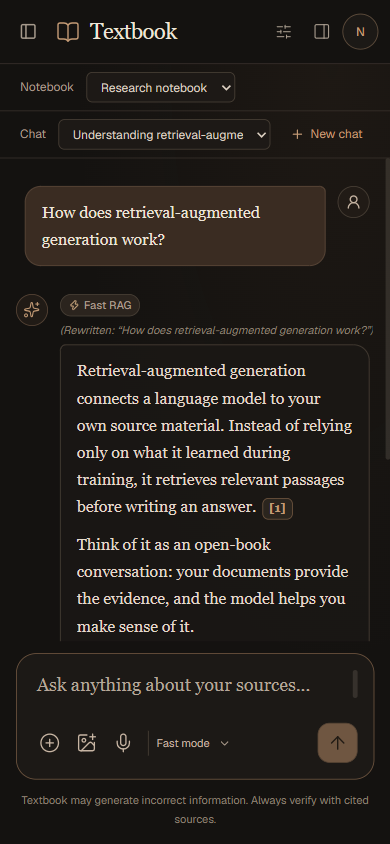

# Textbook UI redesign — issue #51

The reference direction is implemented as matte charcoal surfaces, ivory serif reading text, muted copper controls, fine borders, and a very faint warm background. Animated shader borders and audio backgrounds were removed. Navigation, composer, sources, conversations, citations, Studio, diagnostics, auth, and voice controls use the same visual treatment.

## Browser verification

Verified in Chromium through Playwright at `http://localhost:3000/` and the production server at `http://localhost:3016/` on October 13, 2026. The Browser plugin was unavailable. Desktop screenshots are 1600 × 1000; mobile screenshots are 390 × 844. Layout was also checked at 320 × 640, 768 × 1024, and 1280 × 800.

The welcome screenshots show the actual signed-out home route from the production build, including verified sign-in and mobile source-panel interactions. Research screenshots show the actual application components with controlled notebook, conversation, citation, search, and silent WAV responses. A temporary fixture supplied the authenticated UI state and was removed before the production build. Next.js development chrome was hidden only during research screenshot capture.

| Check | Result |
| --- | --- |
| Page identity, meaningful content, framework overlay | Pass — Textbook title and main screen, no overlay |
| Console health after final reload | Pass — no app errors or warnings |
| Responsive layout | Pass — no horizontal overflow at checked widths; 320px header controls do not overlap |
| Signed-out composer and controls | Pass — send, source upload, image attachment, voice, and suggestions open sign-in; draft and focus survive Escape |
| Saved chat and notebook controls | Pass — new chat clears the view, send renders an SSE response, saved chat restores messages, notebook switching resets scope |
| Citations and Studio | Pass — popover shows excerpt/relevance, View Source opens Studio, Save to Notes stores a scoped note |
| Sources | Pass — select-all updates individual selection; inspect dialog shows file size/date/path |
| Diagnostics | Pass — query renders candidate chunk and rerank score |
| Audio playback | Pass — valid fixture audio loads, seek and playback-speed controls update |
| Mobile panels | Pass — source/Studio toggles, Escape, and backdrop close respond |
| Reduced motion | Pass — shared CSS respects the browser preference; no shader animation remains |

## Automated validation

- `npm run build`
- `npx tsc --noEmit`
- `npm run lint`
- `npx --yes --package=node@24 node --test tests/citations.test.mjs tests/event-stream.test.mjs tests/tenant-isolation.test.mjs` — 24 tests
- `npm run verify:voice-text`
- `git diff --check`

Node 24 was used for the existing TypeScript-based tests because the host's Node 22.12 does not support their native TypeScript loader and `registerHooks` setup. Production build uses the installed Node version. Live OAuth, model generation, speech synthesis, and file ingestion were not exercised; browser research data and audio were fixtures. Backend, auth clients, API contracts, hooks, and stores are unchanged by this PR.

## Final screenshots

