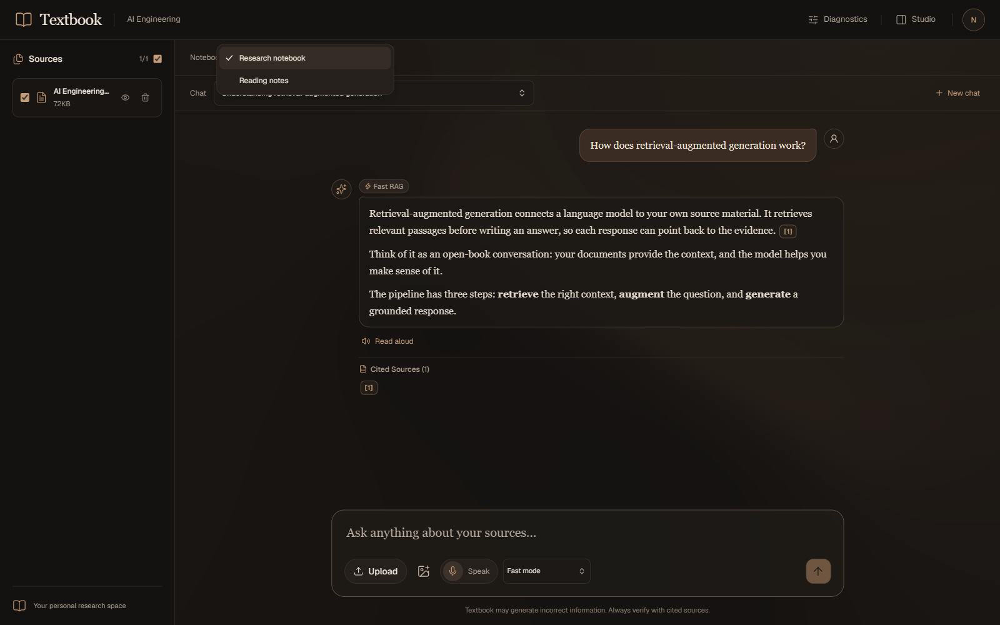
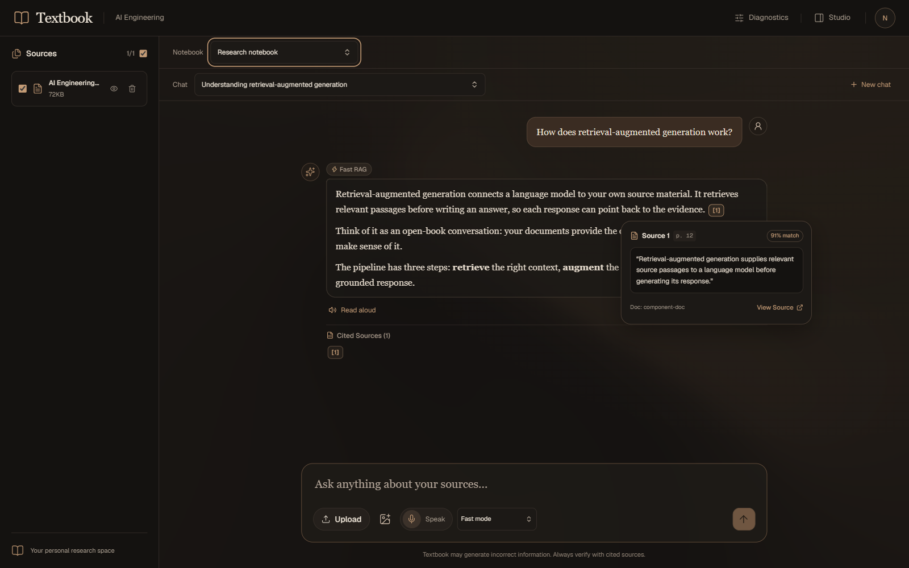
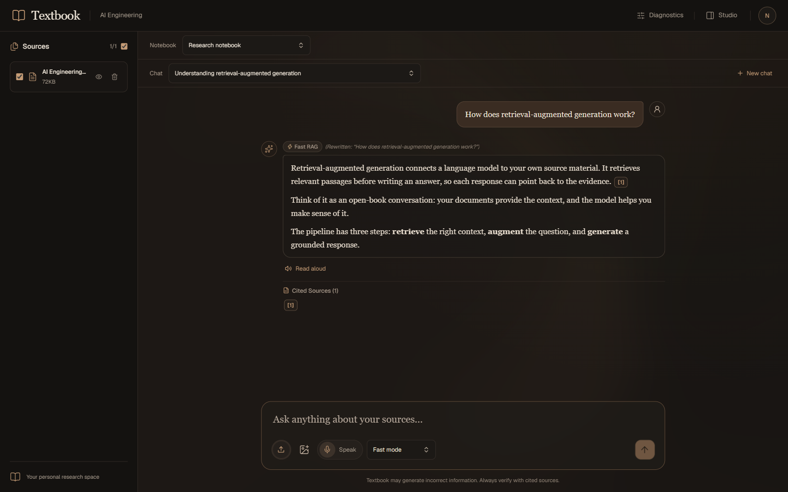
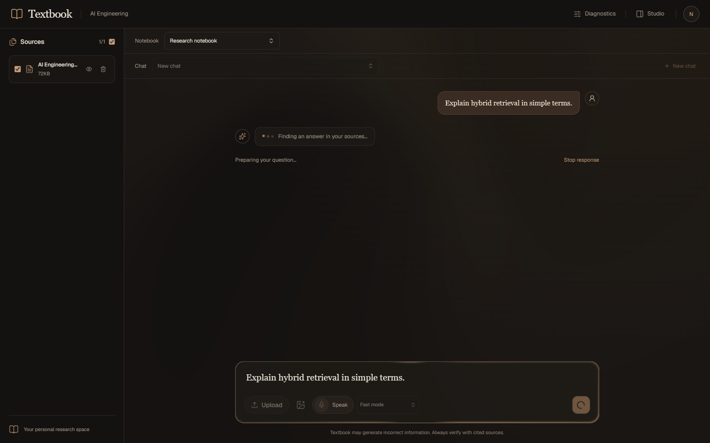
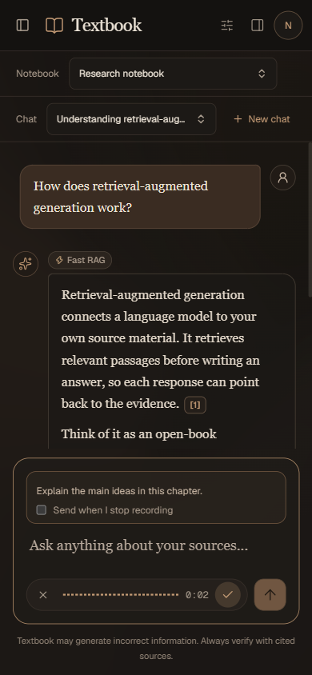

# Textbook UI redesign — issue #51

The reference direction is implemented as charcoal surfaces, ivory serif reading text, muted copper controls, fine borders, and subdued warm Paper mesh backgrounds. The busy composer uses a thin low-bloom Paper pulse. Navigation, composer, sources, conversations, citations, Studio, diagnostics, auth, and voice controls use the same visual treatment. The requested Xevrion, Spectrum, and Skiper components are documented with original URLs in the [component inventory](../../ui-components.md).

## Browser verification

Verified in Chromium through Playwright at `http://localhost:3000/` and the production server at `http://localhost:3016/` on October 13, 2026. The Browser plugin was unavailable. Desktop screenshots are 1600 × 1000; mobile screenshots are 390 × 844. Layout was also checked at 320 × 640, 768 × 1024, and 1280 × 800.

The welcome screenshots show the signed-out production route, including verified sign-in and mobile source-panel interactions. Research screenshots show actual application components with controlled notebook, conversation, citation, search, upload, and silent WAV responses. Voice verification used a virtual Web Audio stream with the browser's real MediaRecorder/AudioContext and a controlled SpeechRecognition transcript. A temporary route supplied authenticated UI state and was removed before the production build. Next.js development chrome was hidden only during research screenshot capture.

| Check | Result |
| --- | --- |
| Page identity, meaningful content, framework overlay | Pass — Textbook title and main screen, no overlay |
| Console health after final reload | Pass — no app errors or warnings; the intentional upload 503 showed the expected retry state |
| Responsive layout | Pass — no horizontal overflow at checked widths; fixed the 320px reasoning/send overlap |
| Signed-out composer and controls | Pass — send, source upload, image attachment, voice, and suggestions open sign-in; draft and focus survive Escape |
| Saved chat and notebook controls | Pass — new chat clears the view, send renders an SSE response, saved chat restores messages, notebook switching resets scope |
| Citations and Studio | Pass — popover shows excerpt/relevance, View Source opens Studio, Save to Notes stores a scoped note |
| Xevrion hover cards | Pass — hover preview, keyboard focus into View Source, Escape focus return, pinned mobile preview within viewport |
| Xevrion selects | Pass — keyboard arrows/typeahead/End/Enter, notebook switching, reasoning selection, speed selection, and portaled document selector inside diagnostics |
| Xevrion upload button | Pass — indeterminate pending state without fake percentage, actual completion, injected failure, retained-file retry and recovery |
| Sources | Pass — select-all updates individual selection; inspect dialog shows file size/date/path |
| Diagnostics | Pass — query renders candidate chunk and rerank score |
| Audio playback | Pass — valid fixture audio loads, seek and playback-speed controls update |
| Spectrum voice input | Pass — virtual audio capture, real elapsed timer/waveform, stop/transcript insertion, cancellation retaining draft, finite seekable recording review |
| Spectrum thinking dots | Pass — pending reply shows dots and busy composer pulse; history controls disabled; completed SSE renders answer |
| Skiper caret | Pass — multiline/newline tracking, selection hides custom caret, IME and RTL use native caret, reduced motion restores native caret |
| Mobile panels | Pass — source/Studio toggles, Escape, and backdrop close respond |
| Reduced motion | Pass — Paper canvases unmount, native caret returns, dots remain legible with animation disabled |

## Automated validation

- `npm run build`
- `npx tsc --noEmit`
- `npm run lint`
- `npx --yes --package=node@24 node --test tests/citations.test.mjs tests/event-stream.test.mjs tests/tenant-isolation.test.mjs` — 24 tests
- `npm run verify:voice-text`
- `git diff --check`

Node 24 was used for the existing TypeScript-based tests because the host's Node 22.12 does not support their native TypeScript loader and `registerHooks` setup. Production build uses the installed Node version. Live OAuth, model generation, vendor speech, hardware microphone input, and backend ingestion were not exercised; research/API data and speech-recognition output were controlled fixtures. Backend, authentication clients, API contracts, and stores are unchanged; the existing voice hook only changes waveform color to copper. The image-generation/Heatmap feature remains pending in PLAN.md.

## Final screenshots

